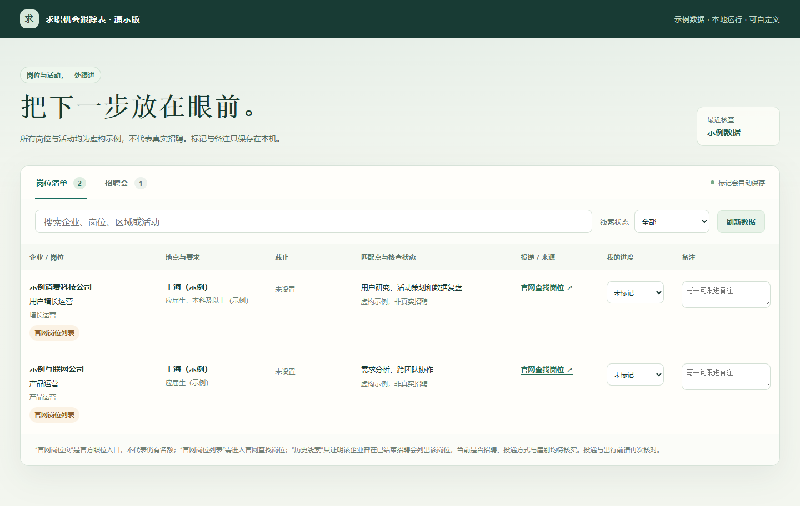

# 求职机会与投递跟踪表

**将分散的岗位、招聘会和投递进度，整理到一个本地网页。**

## 项目简介

面向求职过程中信息分散、进度难以追踪的问题，用一个本地工具集中管理职位、招聘活动及个人跟进状态。

## 主要功能

- 分表查看岗位与招聘会，支持关键词搜索和条件筛选。
- 展示岗位要求、截止时间，以及活动时间、地点和来源。
- 记录投递或参会状态与备注，保存在本机。
- 使用稳定记录 ID，更新信息时保留已有标记。

**技术与实现**：Python、HTML、CSS、JavaScript 和 JSON；由求职场景驱动，借助 AI 辅助开发。

**使用边界**：仓库中的岗位和招聘会为虚构演示数据；当前版本面向单机使用，不提供云同步、实时抓取或自动投递。请勿将真实投递记录等敏感信息提交到公开仓库。
